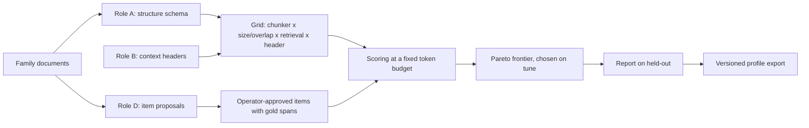

<!-- Tujuan: README publik repo app (bahasa Inggris, H-018): apa, kenapa, cara jalan, batas, disclaimer. -->
<!-- Sumber keputusan: H-002, H-004, H-005, H-006, H-007, H-013, H-014, H-016, H-017, H-018, H-028, H-029, H-031, H-032, H-039, H-041, H-043, H-044, H-045, H-047, H-048, H-051, H-053, H-054, H-060, H-078, H-086, H-089, H-090, H-091, H-093, H-097, H-098, H-100, H-101, H-102, H-104, H-110, H-111, H-112, H-113, H-114. -->

# LexRAGLab

Bahasa Indonesia: [docs/README.id.md](docs/README.id.md)

[](https://github.com/ziffan/LexRAGLab-Meta2026Hackathon/actions/workflows/ci.yml)
[](LICENSE)
[](https://ziffan.github.io/LexRAGLab-Meta2026Hackathon/)

Find the chunking and retrieval setting that feeds an LLM the right clauses of Indonesian legal documents, measured, not guessed.

LexRAGLab measures a grid of chunking and retrieval settings for a document family against operator-approved gold spans at a fixed token budget, and outputs a versioned setting profile you plug into your own RAG pipeline.

Indie track, theme "Build for Your World", built with Muse Spark (`muse-spark-1.3-contributor` through the Meta Model API) for the Meta Global AI Developer Hackathon, 26 Oct to 4 Nov 2026.

- Demo video: https://youtu.be/BMXQfIeGhqw
- Live replay (no API key): https://ziffan.github.io/LexRAGLab-Meta2026Hackathon/
- Example profile: [`profiles/uupt/`](profiles/uupt/)

> Research demo. Not legal advice.


## Headline results

- **One statute, a 2,000-token context.** The Company Law consolidation is 46,583 tokens (clean text, local tokenizer). The selected setting retrieves within a 2,000-token budget: 6 of the 8 held-out items with a gold span fully covered, mean span recall 0.75. Sources: `runs/measure/5db7720bc1f5a121.json` (row `_document`), `profiles/uupt/d7a9dd244260e256789d10d02bd50b1f125bcd1b8a088f2a8058c2f222c58ebf.json` (field `held_out`).
- **Structure induced for a family with no parser.** Muse Spark read sample notarial deeds and proposed their hierarchy schema; with the operator-corrected schema, dense retrieval, header off: 69 of 69 gold items fully covered, vs 64 of 69 for fixed-size 512 / 64 and 0 of 69 for one chunk per deed (over budget). Transfer test on five synthetic deeds. Sources: `runs/grid/86e701f56a3bc5f83268b4cf8590d9dfe641773b8234b3e826c4c4db2b517c2e.json`, [docs/RESULTS.md](docs/RESULTS.md).
- **Citations checked without an LLM.** In role C the model answers from the best and the baseline profile with citations; a deterministic verifier checks that each citation exists and is faithful to the source.
- **Reproducible profile.** The exported profile is hashed; loading it rebuilds the same chunk set and is rejected if the corpus hash differs ([`profiles/uupt/`](profiles/uupt/)).

Small n, raw counts, no significance claims; see [Limits](#limits).

## Who it is for and how it is used

The target user is a legal engineer or RAG team building retrieval over statutes, deeds, or similar document families who wants measured settings instead of guesses. Today the chunk size comes from a tutorial; in Indonesian regulation a guess can cut an *ayat* (paragraph of an article) in half, the model then cites half a rule, there is no number to defend, and a new document family means guessing again.

1. **Add a document family** as plain text (one statute, a set of deeds).
2. **Review what Muse Spark proposes:** the structure schema (role A) and the evaluation items with gold spans (role D). The operator corrects or approves them in the review screens; nothing unapproved is used.
3. **Run the grid, pick a point on the frontier, export the profile,** then load it in your own pipeline. The profile carries the chunker, schema version, retrieval mode, header setting, budget, and hashes.

Internal policies are the next planned family; no documents are included.

## How Muse Spark is used

| Role | What Spark does | Why it matters |
|---|---|---|
| A. Structure induction | Reads sample documents of a new family and proposes a flat hierarchy schema that a deterministic chunker runs | A family with no parser gets a structure-aware chunker without hand-written rules |
| B. Contextual chunking | Writes a short context header for each chunk, with the source document cached as a fixed prefix | Header on/off is a grid axis and header tokens count against the budget, so the effect is measured, not assumed |
| C. End-to-end check | Answers an item from the best profile and from a baseline profile, with citations | A deterministic verifier checks every citation, so the setting is tested at the answer level without an LLM judge |
| D. Item proposals | Proposes (query, gold span) pairs in literal, paraphrase, and unanswerable modes | The operator reviews every proposal and only approved items are used, so the gold set grows while the operator stays the only approver |

> **Unexpected capability.** Role A is structure induction: from sample documents alone, Muse Spark proposed the hierarchy schema of the notarial deeds, a family with no existing parser, and the deterministic chunker ran on it. The operator corrected the proposal; both versions are kept (`runs/schemas/<family>/v1.json` = Spark proposal, `v2.json` = operator correction).

Main results use `muse-spark-1.3-contributor` through the Meta Model API (Responses API with strict structured output, reasoning effort `low`). Role D uses the Contributor model only. The grid search itself uses no LLM, and the citation verifier in role C is deterministic, not a model.

<details>
<summary>Comparators, tokenizer, effort sweep, and the video check</summary>

| Model | Access / host | Roles | Status | Stored runs |
|---|---|---|---|---|
| Muse Spark `muse-spark-1.3-contributor` | Meta Model API, Responses API with strict structured output, Contributor mode (see [Data and licensing](#data-and-licensing)) | A, B, C, D | Main results (reasoning effort `low`); the effort sweep (`medium`, `high`, `xhigh`) is stored separately | `runs/spark/records/`, `runs/schemas/<family>/` (`v1.json` = Spark proposal, `v2.json` = operator correction), `runs/headers/`, `runs/grid/`, `runs/answers/`, `runs/proposals/` |
| Muse Spark Open `meta-models/muse-spark-open-1026` | hosted endpoint on Baseten, Responses API, strict structured output | A, B, C | Comparator, separate runs, never mixed with main results | `runs/schemas/<family>/compare/`, `runs/headers_compare/`, `runs/grid_compare/`, `runs/compare_report/c/` |
| Muse Spark Open tokenizer (`meta-models/Muse-Spark-Open-816B-A42B`, revision pinned in `config/tokenizer.toml`) | local, read from the user's Hugging Face cache, not included | no role: counts tokens for every setting and the token budget (no model call) | Used for all token counts ("Built with Muse Spark Open"; `o200k_base` fallback) | `config/tokenizer.toml` |
| Muse Glimmer `meta/muse-glimmer` (Q4_K_M) | local on the operator's machine, OpenAI-compatible loopback endpoint, client-side schema validation; weights not included; Apache-2.0 per Meta docs (model card not yet verified, see `NOTICE`) | A, B, C | Comparator, separate runs | same comparator directories |
| Muse Voice Transcribe `muse-voice-transcribe-1.0` | Meta Model API transcription endpoint (model ID pinned in `config/voice_qa.toml`) | none in the product: checks the demo video narration against its script | Video QA only, not part of the product; does not affect any result | `runs/voice_qa/` |

Comparators: the two open-weight models re-run roles A, B, and C as separate, labelled runs, selectable in the evidence panel for role C. For role C they answered six items only (three demo items and three Company Law must-refuse items), and no general claim is made about either model's quality. The effort sweep varies reasoning effort per role and model. Details and per-pool spend: [docs/LIMITS.md](docs/LIMITS.md).

</details>

## How it works



For one family of documents with a homogeneous pattern, LexRAGLab searches a grid of settings (chunker, chunk size and overlap, dense / BM25 / hybrid retrieval, context header on or off) and reports which settings give the most gold evidence for a fixed token budget. The output is a **versioned setting profile** you can export and reuse in your own RAG pipeline; loading it back rebuilds the same chunk set (checked by a hash) and is rejected if the corpus hash differs. The project stops at finding the setting; it is not a RAG product.

- Gold evidence is stored as **character spans** in the source document, so one item set can score any chunker. A gold span marks every *ayat* needed for the answer; it is split at *ayat* boundaries before Recall@K is computed.
- Settings are compared at a **fixed token budget**, not a fixed K. Tokens are counted with one local tokenizer for every setting.
- Main metrics: **span recall** and **token precision**. Also reported: MRR, Recall@K, entity preservation, boundary coherence.
- Results are shown as a **Pareto frontier** (recall vs tokens: settings not beaten on both). Settings are chosen on a **tune** split and reported on a **held-out** split, per item, with raw counts and no significance claims.
- A **must-refuse** item is one whose answer is not in the source; the right output is to refuse.

## Results

**Company Law.** Selected setting: structure-schema chunker (schema v2), dense retrieval, header off, 2,000-token budget. Held-out (10 items; 4 operator-written, 6 Spark-proposed and approved): 6 of the 8 items that have a gold span fully covered, mean span recall 0.75, mean token precision 0.0218; raw counts, no significance claim. Source: the exported profile `profiles/uupt/d7a9dd244260e256789d10d02bd50b1f125bcd1b8a088f2a8058c2f222c58ebf.json` (field `held_out`); held-out results are also shown on the report screen of the app. The two misses are both paraphrase items and fail for different reasons. `kontrol-K-07` (operator-written, "dismissal of a commissioner") is a retrieval miss: its gold span is Article 119, a one-sentence cross-reference ("Article 105 applies mutatis mutandis"), and none of the top 5 chunks contain it (Recall@5 = 0); the context holds the longer neighbouring articles on commissioners and directors instead. `usulan-dbd56534fe41df4e` (Spark-proposed, on the social and environmental responsibility duty in Article 74) is a budget miss: the gold chunk is in the top 5 (Recall@5 = 1), but the two higher-ranked structure chunks, Article 1 (definitions) and the General Elucidation (Penjelasan Umum), fill 1,941 of the 2,000 tokens, so it is never packed. Source: stored retrieval for the selected setting (`d7a9dd24…`, endpoint R5) and the per-item rows of the held-out report.

**Token precision** is gold tokens divided by retrieved tokens over the packed context ([docs/EVAL-SPEC.md](docs/EVAL-SPEC.md) section 5): a token is gold only if all its characters lie inside a gold span, header tokens are never gold, and tokens repeated through overlap add to the denominator but not to the numerator, which deliberately penalises repeated context; because the denominator is the whole packed context, a context packed up to the budget with whole chunks scores low on this metric even when the gold span is fully covered.

**Document families.**

| Family | Scope |
|---|---|
| Indonesian Company Law (UU 40/2007), unofficial consolidation as of 30 December 2022 | Full: grid and roles A, B, C, D; settings chosen on tune, reported on held-out |
| Notarial deeds | Transfer: five synthetic deeds of establishment; role A on a family with no existing parser; transfer test, no profile selection |
| Internal policies | Mentioned as the next family; no documents included |

**Evaluation items.** Company Law 23 items (tune / held-out split 13 / 10); notarial deeds (synthetic) 84 items (69 with a gold span, 15 must-refuse), no split. Breakdown by origin and mode: [docs/RESULTS.md](docs/RESULTS.md).

**Deed transfer test** (69 gold items, 2,000-token budget; the Company Law setting applied to the deeds, nothing selected on them):

- deed structure schema v2, dense, header off: 69 of 69 items fully covered, mean span recall 1.000.
- fixed-size 512 / 64, dense, header off: 64 of 69.
- unstructured (one chunk per deed): 0 of 69.

This is a transfer test on five synthetic documents, not the main result and not a general claim. Full table, notes (transfer setting, unstructured, Recall@K not comparable, small n), and sources: [docs/RESULTS.md](docs/RESULTS.md).

## Why: Build for Your World

The hackathon theme is "Bring Meta's models into your domain. Solve a problem you know firsthand, free up time and mental space, and make something possible that wasn't before." The domain here is Indonesian law.

- **A problem known firsthand.** The operator (the project's sole developer) does agentic legal work (legal opinions, legal due diligence, contract drafting) in which the agent must consult a body of regulation that does not fit one context window.
- **Time and mental space.** LexRAGLab aims to replace guessing a chunk size with a measured choice, and to keep the context an agent needs small. This is the hypothesis the evaluation tests, not a measured saving.
- **Something that wasn't possible before.** There is no public, standard benchmark for Indonesian legal RAG, so a retrieval setting for Indonesian legal text could not be chosen by measurement. Muse Spark reads a new document family, proposes its structure and evaluation items for operator review, and LexRAGLab scores every setting against the approved gold spans.

The scale of the problem, from the operator's measurements of prior engagements (not included in this repository; these are not outputs of this app, and nothing in LexRAGLab's results is derived from them): a single statute consulted for one legal opinion was about 320 thousand tokens, more than a 200-thousand-token window on its own, and only about 10% of that regulation text was actually used; whole material per job, composition not broken down into regulation versus other documents, was about 1.2 million tokens for one transaction's legal opinion and about 5.8 million for a full due diligence file (1.2 to 5.8 times a 1-million-token window), about 2.2 million for contract drafting, or about 2.8 million with the clause library included. Operator measurements of agent usage (secondary) are in [docs/DATA.md](docs/DATA.md#operator-measurements-background).

## Run it

Requirements: Python 3.12 with [uv](https://docs.astral.sh/uv/), Node.js with npm. Copy `.env.example` to `.env` and fill the values locally; `.env` is git-ignored and never committed. Keys are needed only for live runs: `MUSE_API_KEY` / `MUSE_BASE_URL` for Contributor, `BASETEN_*` only for the comparator. Replay needs no key.

```bash
uv sync                                   # backend dependencies
uv run python -m backend.api              # backend, bound to 127.0.0.1:8000 only
uv run python -m backend.api --replay     # same, replay mode: stored results only, REPLAY badge, no API key needed (recording/demo)
cd frontend && npm install && npm run dev # frontend dev server on 127.0.0.1:5173, proxies /api to the backend
```

Local replay mode: the backend serves every screen from stored runs (`runs/`) and the document and item data (`data/`) without calling the Model API (some views also need local models; see "Local models for replay" below).

Static replay export (no backend, no model calls):

```bash
uv run python -m backend.replay.export --out dist-static   # writes dist-static/data from stored runs
cd frontend && npm run build:static                        # builds the static UI into dist-static/
uv run python -m backend.replay.export --check dist-static # scan the snapshot for keys, local paths, hosts
uv run python -m http.server -d dist-static -b 127.0.0.1 8080
```

`dist-static/` is build output and is not in the repository. The published live replay (link above) is this static export: no backend, no API key, and no model calls.

**Local models for replay.** Checked on a clean clone with an empty Hugging Face cache and `HF_HUB_OFFLINE=1`: the replay backend starts, and the health, family, snapshot, document text, and run log endpoints work without any Hugging Face model. Per-item retrieval and the fixed-size chunk view need two models in the local Hugging Face cache: the `BAAI/bge-m3` embedder (revision pinned in `config/retrieval.toml`) and the Muse Spark Open tokenizer (revision pinned in `config/tokenizer.toml`). The app does not download them; without them those endpoints return HTTP 500, and the static export writes nothing: it prints the failed requests per file type and exits with code 3 (`--allow-missing` writes a partial export for development only). The `o200k_base` fallback tokenizer was downloaded by `tiktoken` on the first request; a run without network access was not tested.

## Running tests

Tests never call the Model API and need no `.env`. CI runs the frontend suite and a light backend subset (no torch, no gated tokenizer); the full backend suite runs locally only. Commands, requirements, and what CI skips: [docs/TESTING.md](docs/TESTING.md).

## Limits

- Small item sets; results are per item with raw counts, without significance claims.
- The consolidation covers one statute only, as of 30 December 2022; later amendments are not reflected.
- Comparators are separate runs; no quality claim is made about them. The main results stay on `muse-spark-1.3-contributor` at reasoning effort `low`.
- Deed results rest on five synthetic documents; there are no operator-written control items and no held-out split for deeds, and the transfer test selects nothing.
- Token counts use a local tokenizer calibrated once against the API token-count endpoint; billed tokens may differ. The "valid on date" citation check (whether a cited provision was in force on a given date) is a stretch goal and may be absent.
- Run cost (main results): 561,741 micro-USD (shown as $0.561741), the same figure and label as the app header.

Experiment spend per pool (comparator, effort sweep), the comparator details, and the remaining limits are in [docs/LIMITS.md](docs/LIMITS.md).

## Built before vs during the hackathon

The hackathon started on 26 Oct 2026, 23:00 WIB. The first commit in this repository is dated 26 Oct 2026 23:23 WIB, after kickoff. All code was written during the hackathon (26 Oct to 4 Nov 2026); no pre-event prototype is included or copied.

Only two things in this repository were prepared before kickoff (drafted 25-26 Oct, committed afterwards, each in a separately labelled commit):

| Built before kickoff (25-26 Oct 2026) | Built during the hackathon |
|---|---|
| The planning specs in [`docs/`](docs/), imported in one labelled commit (`docs: import pre-event planning`). Planning only: no code | All code, configuration, prompts, evaluation items, synthetic deeds, stored runs, profiles, and the live replay |
| The Company Law file: an unofficial consolidation of UU 40/2007, consolidated as of 30 December 2022, prepared by the operator from the regulation texts and Constitutional Court decisions; committed separately as pre-event material (`data: add UU 40/2007 consolidated text`) | Every change to the specs after the import commit |

The visual theme of the UI (colour tokens, IBM Plex typography, component patterns) follows the operator's pre-event design mockup, which is not in this repository; the markup is not copied and the layout follows `docs/UI-SPEC.md`. The five synthetic deeds were written during the hackathon by an AI agent (the development agent) and reviewed by the operator.

## Data and licensing

- The Company Law text is an unofficial consolidation of UU 40/2007 (as of 30 December 2022), prepared by the operator from public regulation texts and Constitutional Court decisions. The deeds are synthetic and fictitious; no real deeds, client data, or internal documents are included.
- Model API calls use `muse-spark-1.3-contributor` (Contributor mode: Meta may use the content to train future models). This is acceptable here because every document is public or synthetic. For confidential document families, set the Standard model ID in `config/model.toml`.
- License: Apache-2.0 for everything this project created (see `LICENSE`); third-party attributions are in `NOTICE`.

**Built with Muse Spark Open.** The Muse Spark Open tokenizer counts tokens locally (the Muse Model License requires this notice), and the Muse Spark Open model is also a comparator.

Corpus sources, full licensing details (fonts, UU 28/2014 Article 42, tokenizer and Glimmer licenses, dependency licenses): [docs/DATA.md](docs/DATA.md).

## Disclaimer

Research demo. Not legal advice. Do not rely on any output for legal decisions.

## Documentation

Spec documents are written in Indonesian. Specs live in [`docs/`](docs/): [PRD](docs/PRD.md), [UI-SPEC](docs/UI-SPEC.md), [ARCHITECTURE](docs/ARCHITECTURE.md), [DATA-CONTRACTS](docs/DATA-CONTRACTS.md), [API](docs/API.md), [EVAL-SPEC](docs/EVAL-SPEC.md), [SPARK-ROLES](docs/SPARK-ROLES.md), [SECURITY-COMPLIANCE](docs/SECURITY-COMPLIANCE.md), [MILESTONES](docs/MILESTONES.md), [DECISIONS](docs/DECISIONS.md), [VIDEO](docs/VIDEO.md). Detail documents in English: [LIMITS](docs/LIMITS.md), [RESULTS](docs/RESULTS.md), [DATA](docs/DATA.md). Indonesian README: [docs/README.id.md](docs/README.id.md).

<details>
<summary>Repository map</summary>

```text
backend:   Python 3.12 + FastAPI
frontend:  React + TypeScript + Vite
model:     muse-spark-1.3-contributor, Responses API (model ID in config/model.toml)
storage:   files only (no database, no vector database)
```

| Directory | Contents |
|---|---|
| `backend/` | Python backend: grid search, scoring, Model API clients, replay export, tests |
| `frontend/` | React + TypeScript UI |
| `config/` | Versioned settings (`model.toml`, `tokenizer.toml`, `grid.toml`, `budget.toml`, `sweep.toml`, `voice_qa.toml`, and others) |
| `data/` | Corpus, synthetic deeds, evaluation items |
| `runs/` | Stored runs; every reported number comes from here |
| `profiles/` | Exported setting profiles |
| `prompts/` | Prompts per role (`a` to `d`) |
| `docs/` | Specs, decisions, and detail documents |
| `video/` | Demo video motion graphics and the narration checker (`video/qa/`); not part of the app |
| `licenses/` | Font license texts |

</details>

<details>
<summary>For AI agents and contributors</summary>

- Read [`AGENTS.md`](AGENTS.md) first (rules for agents, written in Indonesian). Its reading order: `docs/CONTEXT.md`, `docs/DECISIONS.md`, `docs/ISSUES.md`, `docs/MILESTONES.md`, the spec of the slice being worked on (listed in the "Spec per slice" section of `docs/MILESTONES.md`), `docs/CONVENTIONS.md`, `docs/GOTCHAS.md`; `docs/PRD.md` and `docs/ARCHITECTURE.md` as reference.
- Key rules from `AGENTS.md`: agents never write or approve evaluation items; numbers come only from stored runs and are never invented; no model other than `muse-spark-1.3-contributor` except the exceptions listed there (the comparators and the video check); no database, vector database, LangChain, PDF parser, or reranker; API keys live only in the local `.env`.
- Spec documents are written in Indonesian. IDs like `H-028` refer to entries in the operator decision log, summarised in `docs/DECISIONS.md`. Family codes: `uupt` = Company Law, `akta` = notarial deeds.
- Model profiles (main and comparators) are in `config/model.toml`, which `AGENTS.md` calls `config/model`.

</details>
