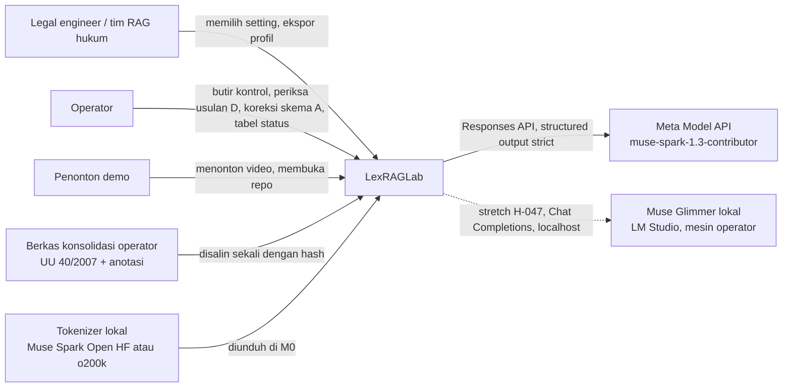
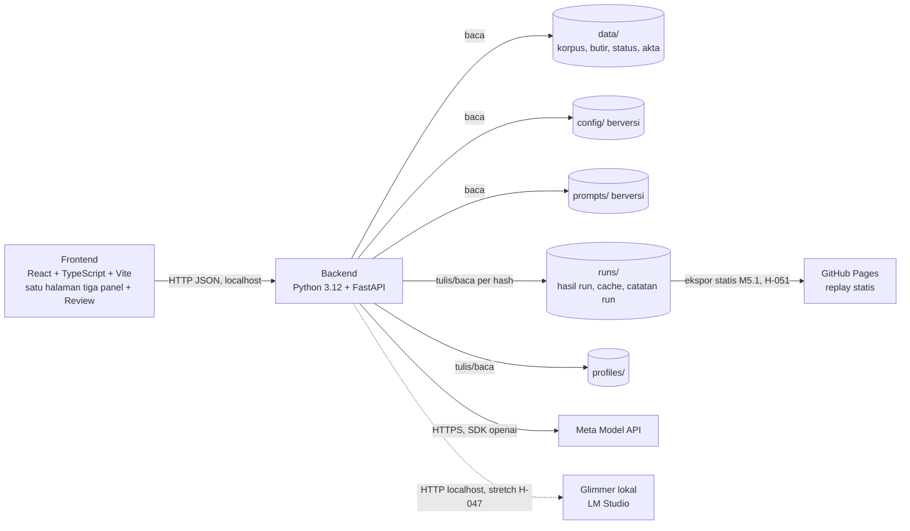

# ARCHITECTURE — LexRAGLab

Tujuan: menetapkan bentuk sistem (C4 konteks, kontainer, komponen), struktur repo, konfigurasi, cache, NFR, dan failure mode sebelum kode.
Sumber keputusan: H-003, H-004, H-005, H-009, H-012, H-013, H-014, H-015, H-016, H-017, H-020, H-025, H-027, H-028, H-031, H-032, H-034, H-042, H-045, H-046, H-047, H-049, H-050, H-051, H-053, H-054, H-055.

## 1. Prinsip

- **Configuration over hardcoding.** Model id, effort, harga, sumbu grid, anggaran, ambang fuzzy, parameter RRF, granularitas B, dan batas biaya ada di `config/` berversi. Kode **DILARANG** memuat nilai itu sebagai literal.
- **Setiap hasil bisa diulang.** Setiap run mencatat hash korpus, hash konfigurasi, versi prompt, model, effort, token, biaya, latensi (`docs/DATA-CONTRACTS.md` §12).
- **Cache per hash.** Hasil yang kuncinya sama tidak dihitung atau dipanggil ulang.
- **Keadilan antar-setting.** Model, effort, instruksi sistem, bentuk keluaran, anggaran, dan penanda alamat sama untuk semua setting yang dibandingkan.
- **Grid tanpa LLM.** Spark hanya dipanggil untuk peran A, B, C, D (H-004).
- **Tanpa** database, auth, vector database, LangChain, parser PDF, reranker (H-013). Indeks di memori atau berkas.
- **Agen pengembang tidak menulis** butir, tabel status, atau koreksi skema (H-006, H-009).

## 2. C4 tingkat 1 — konteks



Batas sistem: satu mesin operator. Tidak ada backend publik yang di-deploy; versi live hanya ekspor statis mode putar ulang di GitHub Pages, tanpa backend, key, atau panggilan model (H-051). Egress runtime: Meta Model API saja. Glimmer pembanding (stretch, H-047) berjalan di `127.0.0.1`, tanpa egress dan tanpa key.

## 3. C4 tingkat 2 — kontainer



| Kontainer | Tanggung jawab | Protokol |
|---|---|---|
| Frontend | Menampilkan U0–U9 (`docs/UI-SPEC.md`), memegang state pilihan, tidak pernah memanggil Model API | HTTP JSON ke backend di `127.0.0.1` |
| Backend | Semua logika: korpus, chunker, retrieval, metrik, grid, klien Spark, verifier, profil, replay | FastAPI, `docs/API.md` |
| Berkas | Data, konfigurasi, prompt, run, profil. Sumber kebenaran tunggal | Sistem berkas |
| Meta Model API | Peran A, B, C, D | HTTPS, Responses API (H-016) |
| Glimmer lokal (stretch) | Pembanding on-prem peran C saja (H-047, H-053): profil terbaik dan baseline dijalankan ulang. Tidak untuk A, B, D, verifier. Tidak dijalankan bersamaan dengan embedding (VRAM) | HTTP `127.0.0.1`, Chat Completions OpenAI-compatible; model ID, kuantisasi, `reasoning_effort` dari `config/model` |
| Replay statis (H-051) | Frontend + snapshot JSON dari `runs/` dan bagian `data/` yang dibutuhkan (H-050); dipasang setelah repo publik di gate M5.2 | Berkas statis, GitHub Pages |

## 4. C4 tingkat 3 — komponen backend

| Komponen | Masukan | Keluaran | Catatan |
|---|---|---|---|
| Corpus loader | `data/uupt/`, `data/akta/`, daftar sumber, `config/corpus` | `CorpusDoc` (§2), usulan baris status | Baca biner lalu decode UTF-8; tolak `\r`, BOM, dan hash yang tidak ada di `config/corpus` (G-16). Aturan pemuat UU PT (pemisahan anotasi, normalisasi baris kosong, kalimat penutup rincian, lima `section`, alamat kanonik) dan uji penolakan R1–R13 di `docs/DATA-CONTRACTS.md` §2 (H-046). Mencatat `clean_sha256` dan `loader_rules_version`. Berkas hilang/rusak atau anotasi tak terurai ditolak dengan pesan jelas |
| Tokenizer (H-014) | teks | jumlah token lokal | Satu tokenizer untuk semua setting; nama dan versi dicatat di setiap run. Rasio kalibrasi terhadap `/v1/responses/input_tokens` disimpan di `config/tokenizer` per dokumen (UU PT juga per `section`) dan rata-rata |
| Chunker struktur tulisan tangan | `CorpusDoc` | `Chunk[]` (§3) dengan alamat kanonik (bagian › Pasal › ayat › huruf) | Membedakan batang tubuh dan Penjelasan (G-20); kalimat penutup rincian milik ayat, bukan butir terakhir (H-046). Mengenali `Pasal I` Romawi bila teks UU pengubah dimasukkan (G-13). Dokumen tanpa penanda jatuh ke satu potongan per bagian dengan peringatan |
| Chunker ukuran tetap | `CorpusDoc`, ukuran + overlap dari konfigurasi | `Chunk[]` | Alamat diberikan dari peta alamat struktur, sama seperti chunker lain (keadilan); potongan yang melintasi beberapa unit memakai alamat rentang (`docs/DATA-CONTRACTS.md` §3) |
| Chunker skema | `CorpusDoc`, `SchemaA` versi aktif | `Chunk[]` | Deterministik: skema sama → hash potongan sama |
| Header B store | `HeaderB` (§7) | teks header per potongan | Token header masuk anggaran |
| Retrieval dense | potongan, query | ranking | Embedder dari konfigurasi: `BAAI/bge-m3` revisi dipin, dense saja, tanpa prefix (H-042); `max_seq_length` dan jumlah potongan terpotong tercatat (G-22). Embedding dihitung sekali per potongan dan disimpan per hash; format penyimpanan `.npy` per `chunk_set_hash` (H-025) |
| Retrieval BM25 | potongan, query | ranking | BM25 + stemmer Sastrawi untuk bahasa Indonesia |
| Retrieval hybrid | dua ranking | ranking | RRF, parameter dari konfigurasi |
| Budget packer | ranking, anggaran | potongan terambil | Aturan pengemasan di `docs/EVAL-SPEC.md` §3 |
| Metrik | potongan terambil, `Item` | `ItemMetrics` (§10), metrik mutu | Definisi formal di `docs/EVAL-SPEC.md`; span gold dipecah di batas ayat sebelum Recall@K (H-048) |
| Split | `Item[]`, seed, `held_out_ratio` | `SplitRecord` (§4) | UU PT saja: berstrata per asal dan mode, porsi held-out 0,4, minimal tiga kontrol di held-out (H-015, H-049). Akta tanpa split (H-054) |
| Grid runner + frontier | `config/grid`, semua komponen di atas | `GridPoint[]`, `Frontier` (§10) | Tanpa LLM. UU PT: pilih di tune, lapor di held-out; pemecah seri H-034, lalu §9 EVAL-SPEC, lalu `setting_id` terkecil (H-055). Akta: frontier transfer tanpa pemilihan (H-054) |
| Spark client (H-016) | prompt berversi, skema JSON | keluaran tervalidasi + `RunRecord` | SDK `openai`, Responses API, `text.format` dengan `strict: true`, cached tokens dari `usage.input_tokens_details.cached_tokens`, `prompt_cache_key`, request pemanas sebelum batch. Key dari `.env`, tidak pernah dicetak |
| Glimmer client (stretch, H-047) | prompt C berversi, skema JSON | keluaran tervalidasi di sisi klien + `RunRecord` | Chat Completions ke endpoint OpenAI-compatible LM Studio di `127.0.0.1`; tanpa key. Model ID, `Q4_K_M`, dan `reasoning_effort` dari `config/model`. Ketersediaan server diperiksa; bila mati, pilihan Glimmer di W6/U3 nonaktif dengan pesan jelas (H-053) |
| Cost guard | proyeksi token, harga dari `config/model` | izin/tolak batch | Batas biaya per peran di konfigurasi; batch yang proyeksinya melewati batas berhenti sebelum memanggil API |
| Peran A, B, C, D | Spark client | `SchemaA`, `HeaderB`, `AnswerC`, `ProposalD` | Rincian di `docs/SPARK-ROLES.md` |
| Verifier | `AnswerC`, peta alamat, teks sumber, tabel status | `VerifierResult` (§8) | Program biasa, bukan LLM. Uji 3 stretch (H-017) |
| Review store | `ProposalD`, keputusan operator | `Item` baru | Transisi status hanya `usulan → disetujui / diubah / ditolak` |
| Profile exporter/importer | `Setting`, metrik held-out, hash | `Profile` (§11) | Round-trip menghasilkan hash potongan sama; hash korpus beda ditolak |
| Replay | `runs/`, `data/` | respons yang sama dengan mode live | Membaca `runs/` (hasil) dan `data/` (teks dokumen dan butir), tanpa panggilan model kecuali satu panggilan live W6 (H-050); panggilan Spark tanpa run tersimpan ditolak dengan pesan jelas |
| Ekspor statis (H-051) | snapshot R3/R4/R5 dari replay | situs statis | Frontend + snapshot JSON, tanpa backend, key, atau panggilan model; panggilan live W6 tidak ada. Isinya diperiksa di gate M5.2 (tanpa key, tanpa path lokal) |
| API layer | HTTP | JSON | `docs/API.md`; galat tanpa stack trace |

## 5. Komponen frontend

| Komponen | Panel UI-SPEC |
|---|---|
| App shell, pemilih keluarga, lencana replay | U0, U9 |
| ChunkView | U1 |
| FrontierChart (Recharts, H-026) | U2 |
| EvidencePanel | U3 |
| ItemTable + QualityMetrics | U4 |
| SchemaDiff | U5 |
| ReviewQueue (route `/review`) | U6 |
| ProfileExport | U7 |
| RunLog | U8 |

State bersama (snapshot H-020 dan pilihan pengguna) dipegang satu store `useReducer` + context (H-023).

## 6. Struktur direktori repo app

```text
data/
  uupt/            berkas konsolidasi UU 40/2007 (H-031) + daftar sumber + hash
  akta/            lima akta sintetis (H-039), M4
  butir/           butir per keluarga, dengan asal, split, status periksa
  status/          tabel status berlaku berversi (H-009)
config/            model, tokenizer, corpus, grid, retrieval, verifier, budget, header_b (berversi)
prompts/           prompt A, B, C, D (berversi)
runs/              hasil run tersimpan, dikunci per hash
profiles/          profil setting yang diekspor
backend/           korpus, chunker, retrieval, metrik, klien Spark, verifier, API
frontend/          satu halaman tiga panel + layar Review
docs/              suite ini
```

`.env` (berisi key) di `.gitignore`. `.env.example` tanpa nilai.

## 7. Konfigurasi berversi

| Berkas (TOML, H-022) | Isi | Pemilik nilai |
|---|---|---|
| `config/model` | daftar profil model. Profil utama: model ID `muse-spark-1.3-contributor` (H-028), effort per peran, harga input/cached/output, `max_output_tokens`, timeout, retry, batas RPM. Profil pembanding (stretch, H-047, H-053): model ID Glimmer, kuantisasi `Q4_K_M`, `reasoning_effort` `high` (dipin sebelum run, tidak diubah setelah melihat hasil), base URL `127.0.0.1`, hanya peran C | Operator; harga dari halaman pricing Model API, dicek 26 Okt (Contributor: input $0,10 / cached $0,002 / output $0,20 per 1M), dicek ulang di M0 |
| `config/tokenizer` | nama dan versi tokenizer, rasio kalibrasi per dokumen (UU PT juga per `section`) dan rata-rata | Diukur di M0.2 |
| `config/corpus` | hash berkas yang diterima (UU PT: `a6b38ee5…`, H-045), `loader_rules_version`, aturan status default (`berlaku` sejak tanggal pengundangan di blok PENGESAHAN, H-046) | Operator; aturan default disetujui operator |
| `config/grid` | sumbu H-012: chunker, ukuran/overlap, mode retrieval, header B on/off; anggaran default 2.000 dan pembanding; `packing` (default `stop`); `baseline` (H-036); urutan "sederhana" (H-034); seed split; `held_out_ratio = 0.4` (H-049) | Operator; nilai ukuran/overlap dan anggaran pembanding dipilih di M1. Grid sempit sejak hari pertama: satu ukuran pembanding, satu anggaran pembanding (H-017) |
| `config/retrieval` | embedder dan revisinya, `max_seq_length`, parameter BM25, parameter RRF, K untuk Recall@K, `entity_patterns`, pola akhir kalimat, cakupan `section` (default `batang_tubuh`, `penjelasan_pasal`, `penjelasan_umum`, H-046) | Operator |
| `config/verifier` | ambang fuzzy uji 2, versi tabel status | Operator |
| `config/budget` | batas biaya per peran dan total | Operator |
| `config/header_b` | granularitas (H-038), cakupan (semua setting atau hanya frontier, H-017) | Operator, setelah M3.1 |

Setiap berkas punya field `version`. Hash konfigurasi = hash isi kanonik semua berkas yang dibaca run.

## 8. Cache per hash

| Kunci | Isi | Lokasi |
|---|---|---|
| `hash(clean_sha256, loader_rules_version, chunker, chunker_params, schema_version)` | `Chunk[]` | `runs/chunks/` |
| `hash(chunk_set_hash, embedder_name, embedder_revision, max_seq_length)` | embedding | `runs/embeddings/` (`.npy`, H-025, H-042) |
| `hash(clean_sha256, config_hash, item_set_hash, split_version)` | hasil grid | `runs/grid/` |
| `hash(provider, model, quantization, effort, prompt_hash, schema_hash, input_hash)` | keluaran model + `RunRecord` | `runs/spark/<peran>/`; run Glimmer di jalur terpisah (H-047) |

Aturan: kunci ada → baca, jangan panggil. Mode replay hanya membaca (`runs/` dan `data/`, H-050). Menghapus cache adalah tindakan manual operator.

## 9. NFR

| Kategori | Target | Cara ukur |
|---|---|---|
| Reproducibility | Hash masukan sama → keluaran grid, potongan, dan profil identik byte per byte | Test round-trip M4.3, test hash M3.4 |
| Biaya | Total panggilan Spark di dalam kredit $150 (Participant Guide / docs Model API); B dijalankan per granularitas H-038 setelah biaya dan waktu satu dokumen diukur (M3.1) | Agregat `RunRecord` di U8; cost guard |
| Rate limit | Di bawah 150 RPM / 3M TPM (Contributor, H-028, Participant Guide / docs Model API); batas tier kredit belum didokumentasikan | Pembatas laju di klien; A dan B berurutan, bukan paralel; backoff `Retry-After` pada 429 |
| Latensi demo | Mode replay tidak bergantung pada jaringan; satu panggilan live saja; versi statis tanpa panggilan sama sekali (H-051) | Kriteria M5.1: API diputus, semua adegan bisa diputar |
| VRAM | Glimmer dan embedding bge-m3 tidak berjalan bersamaan di mesin GPU (H-047) | Run dijadwalkan terpisah; G-26 |
| Keamanan | Key tidak pernah di repo, log, atau layar; backend hanya listen di `127.0.0.1` | Secret scan M5.2, `docs/SECURITY-COMPLIANCE.md` |
| Waktu | Semua timestamp UTC ISO 8601 | Kontrak §1 |
| Uang | Biaya disimpan sebagai integer micro-USD, bukan float | Kontrak §1 |

Angka latensi dan biaya aktual diukur di M0.1, M0.2, dan M3.1, bukan ditetapkan di sini.

## 10. Failure mode

| Komponen | Failure | Dampak | Deteksi | Mitigasi | Milestone |
|---|---|---|---|---|---|
| Spark client | Key salah, 401 | Peran berhenti | Pesan galat jelas | Pesan tanpa key; replay tetap jalan | M0.1 |
| Spark client | 429 / timeout | Batch macet | `RunRecord.status` | Backoff dari konfigurasi, berurutan, lanjut dari cache | M0.1 |
| Spark client | Keluaran tidak lolos validasi semantik (mis. regex tidak cocok contoh) | Data rusak masuk | Validator per peran | Ditolak, dicatat, tidak di-cache sebagai sah | M2.1, M3.3 |
| Cache Responses | Cache hanya hint, hit rendah | Biaya B naik | `cached_tokens` per run | Request pemanas, `prompt_cache_key`, ukur di M3.1 | M3.1 |
| Cost guard | Proyeksi salah atau loop | Kredit habis | Agregat biaya | Batas per peran, berhenti sebelum batch | M0.1 |
| Corpus loader | Hash beda dari sumber | Hasil tidak bisa diulang | Cek hash | Tolak muat | M0.2 |
| Chunker | Offset tidak cocok teks sumber | Metrik salah | Test offset round-trip | Error, bukan peringatan | M1.1 |
| Metrik | Bug kalkulator | "Optimal" palsu | Test hitung tangan Tier 1 | Skenario test diusulkan agen, dicek pemeriksa independen, disetujui operator (H-052) | M1.2 |
| Split | Held-out bocor ke pemilihan | "Optimal" palsu | Test split | Seed tercatat, pemilihan hanya di tune | M1.4 |
| Review | Usulan masuk evaluasi tanpa keputusan | Butir tidak sah | Test transisi | Satu jalur transisi | M2.1 |
| Verifier | Fuzzy terlalu longgar | Kutipan karangan lolos | Kasus test yang disetujui operator (H-052) | Ambang di konfigurasi, diusulkan dengan alasan tertulis dan disetujui operator | M2.3 |
| Glimmer client | Server LM Studio mati atau OOM VRAM | Pembanding tidak jalan | Cek ketersediaan sebelum panggilan | Pilihan nonaktif dengan pesan jelas; run lama tetap tampil (H-053) | stretch M2.5 |
| Profil | Dimuat dengan korpus lain | Profil tidak berlaku | Cek hash korpus | Tolak dengan pesan | M4.3 |
| Replay | Run tersimpan tidak lengkap | Adegan kosong saat demo | Rekaman kasar 2 Nov | Daftar run wajib per adegan di `docs/VIDEO.md` | M5.1 |
| Ekspor statis | Snapshot memuat key atau path lokal | Bocor di situs publik | Pemeriksaan isi snapshot | Gate M5.2 sebelum dipasang (H-051) | M5.1, M5.2 |
| Frontend | Panel error menjatuhkan halaman | Demo macet | Uji keadaan | Error terisolasi per panel | M5.1 |
